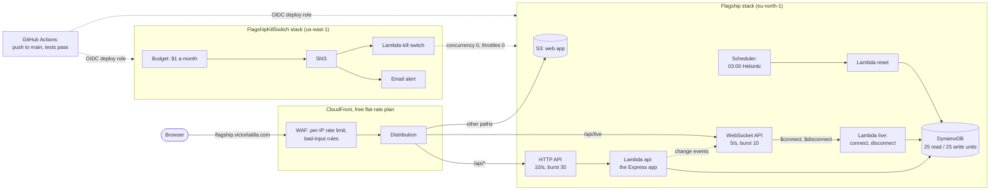
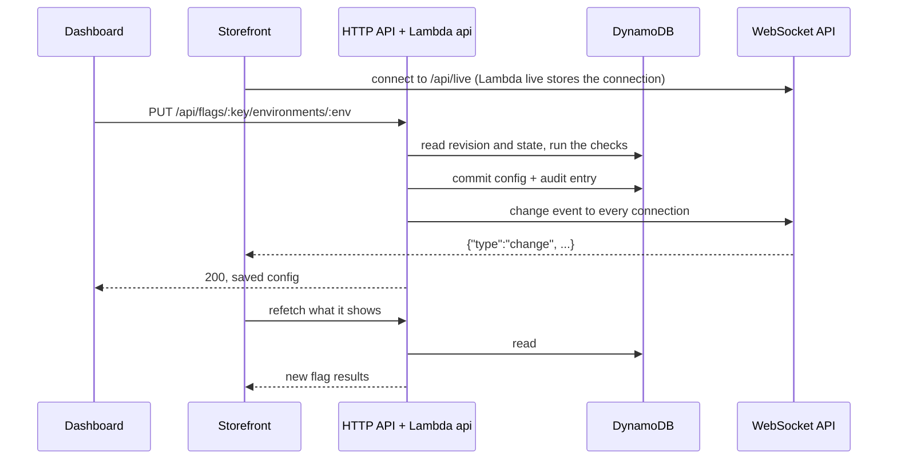
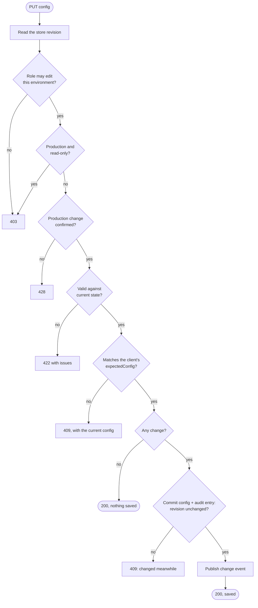

# Architecture

Three diagrams of how Flagship fits together. The reasons are in [Design decisions](DECISIONS.md), the exact limits and settings in the [Reference](REFERENCE.md#deployment-aws).

## The AWS deployment

The public demo ([decision 17](DECISIONS.md#17-a-public-serverless-demo-on-aws-capped-by-throttles-and-a-budget-kill-switch)). Locally, one Express process serves the same API on SQLite, and Vite serves the web app.

- **Pings** (`{"type":"ping"}`) are answered by the WebSocket API itself, so they cost no Lambda time.
- **The kill switch** stops the API and live updates; the web page stays up. `npm run demo:stop` and `demo:restore` run it by hand.

## A config change, end to end

A save in the dashboard reaching an open storefront. Locally the steps are the same, with the Express process in place of API Gateway and Lambda.

Change events carry no data: clients refetch through the normal endpoints ([decision 15](DECISIONS.md#15-live-updates-over-websocket-with-client-side-pings)). Every request goes through CloudFront, left out above.

## The write path

Every config write, including rollbacks, goes through `applyConfig` (`apps/api/src/services/flags.ts`). Other writes (flags, segments) follow the same order in their services.

- **Two conflict checks:** `expectedConfig` catches a change since the user *reviewed* the config ([decision 7](DECISIONS.md#7-optimistic-concurrency-for-every-write)); the revision catches one made *during this request* ([decision 16](DECISIONS.md#16-dynamodb-store-one-table-a-global-revision-guard-and-a-cached-state)).
- **The config and its audit entry** are saved in one atomic commit; a failed change event never fails the request.
